<div align="center">



<a href="https://github.com/eeliazar17-hue">
  
</a>

<br/>


</div>

```text

ESTUDIOS : Desarrollo de Aplicaciones Multiplataforma (1º DAM)
CENTRO   : IES Albarregas

```

## 🍎 Proyectos en marcha

| Proyecto | Descripción |

| 🩴 **ChinelaStock** | App para gestionar mi negocio de chinelas: inventario, precios y ventas |
| ✅ **Taskify Desk** | Gestión de tareas para pequeñas oficinas, desarrollada por fases |

## 🛠️ Stack

<div align="center">


</div>


