<div align="center">



<a href="https://github.com/eeliazar17-hue">
  
</a>

<br/>


</div>

---

## 📓 Sobre mí

```text
NOMBRE   : Enrique Soza
ESTUDIOS : Desarrollo de Aplicaciones Multiplataforma (1º DAM)
CENTRO   : IES Albarregas
ESTADO   : compilando el futuro...
```

Soy estudiante de **DAM** y me gusta convertir ideas en aplicaciones que sirvan de verdad. Mi norte: aprender cada día un poco más y construir cosas útiles.

## 🍎 Proyectos en marcha

| Proyecto | Descripción |
|---|---|
| 🩴 **ChinelaStock** | App para gestionar mi negocio de chinelas: inventario, precios y ventas |
| ✅ **Taskify Desk** | Gestión de tareas para pequeñas oficinas, desarrollada por fases |
| 📬 **Aviso Gmail** | App Android que avisa a diario de los correos sin leer |
| ☕ **Ejercicios de Java** | Prácticas de programación del ciclo DAM |

## 🛠️ Stack

<div align="center">


</div>

## 📊 Estadísticas

<div align="center">


</div>

---

<div align="center">

*"Un buen programador no escribe código: lo escribe con intención."* 🖤


</div>
